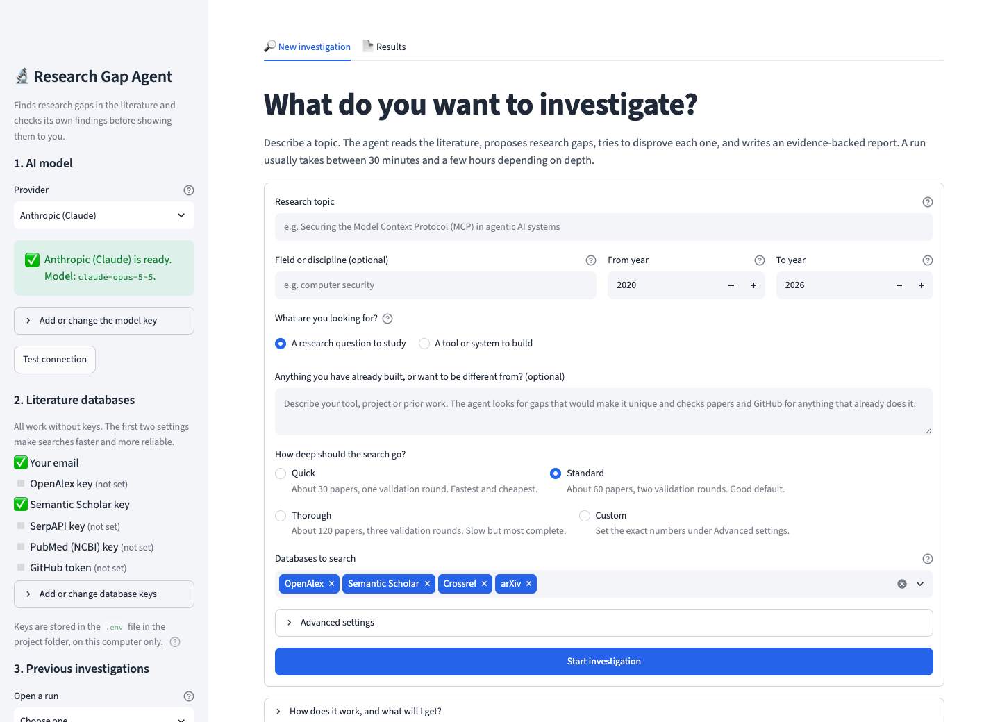

# Research Gap Discovery Agent

Give it a research topic. It reads the literature and tells you what nobody has done yet, with the evidence to back it up.

The agent searches real academic databases (OpenAlex, Semantic Scholar, Crossref, arXiv, PubMed, optionally Google Scholar and GitHub), builds a map of the field, proposes candidate research gaps, and then **actively tries to disprove each one** with counter-searches. Only gaps that survive make it into the report. Every claim is tied to a real paper, and every citation is checked.

## What you get

One run produces a folder in `runs/<run_id>/` containing:

| File | What it is |
|---|---|
| `report.html` | The styled report: research landscape, validated gaps, ranking, recommended direction, reading list, search log |
| `report.md` | The same report as Markdown |
| `appendix.md` | Full evidence matrix, every search query, the verification log, every record |
| `references.bib` / `references.ris` / `corpus.csv` | Import into Zotero, Mendeley or EndNote |

## Quick start

You need Python 3.11+ and an API key for one LLM provider (Anthropic by default).

```bash
# 1. Install
python3 -m venv .venv && . .venv/bin/activate
pip install -e ".[dev,gui]"

# 2. Add your keys
cp .env.example .env     # open .env and fill in ANTHROPIC_API_KEY and RGA_MAILTO

# 3. Run
research-gap-agent "prompt injection attacks on tool-using LLM agents" --from-year 2023
```

Progress prints to the terminal. When it finishes, open `runs/<run_id>/report.html`.

### Prefer a point-and-click app?

```bash
streamlit run app.py
```



The app opens in your browser. Paste your API key once in the sidebar, type a topic, pick a depth
(Quick, Standard or Thorough), and click Start. You can watch each of the twelve steps run, stop and
resume a run, browse and rerun previous investigations, and read the ranked gaps, the full report and
every paper found without touching a terminal. Light and dark themes are built in.

## How it works

```
topic
  │
  ▼
plan ──► discover ──► screen ──► full text ──► extract ──► landscape
                                                                │
                                                                ▼
report ◄── verify ◄── recommend ◄── rank ◄── validate ◄── generate gaps
```

1. **Plan**: break the topic into concepts, synonyms and 6 to 14 search queries.
2. **Discover**: run every query on every source, merge duplicates across databases.
3. **Screen and extract**: keep relevant papers, read open-access PDFs, pull out one structured evidence row per paper.
4. **Landscape**: group papers into themes and record what the evidence does and does not show.
5. **Generate gaps**: propose 3 to 8 candidate gaps, each pointing at specific papers.
6. **Validate**: for each gap, search again with different terminology and chase citations. A gap that turns out to be already addressed is rejected. A gap that is partly addressed is narrowed and checked again.
7. **Rank and recommend**: score the survivors on nine criteria and write a concrete plan for the top one.
8. **Verify**: drop any paper id the model invented, resolve DOIs, flag retractions, confirm that cited abstracts support the claims.

The last step is not a prompt. It is code, and it runs on every output of the model.

## Useful options

```bash
research-gap-agent "topic" --discipline "computer security" --from-year 2022
research-gap-agent "topic" --max-papers 40 --validation-rounds 1     # cheaper run
research-gap-agent "topic" --sources openalex,arxiv,pubmed            # pick databases
research-gap-agent "topic" --goal tool --existing-work @README.md     # looking for a tool to build, not a study
research-gap-agent --resume 20261102-091500-ab12cd                     # continue an interrupted run
research-gap-agent --help                                              # everything else
```

## Using a different LLM

Set one provider's key in `.env` and it is picked up automatically. Supported: Anthropic, OpenAI, Azure OpenAI, Gemini, Mistral, Groq, Together, OpenRouter, DeepSeek, xAI, Ollama, LM Studio, and any OpenAI-compatible server.

```bash
research-gap-agent "topic" --provider openai --model gpt-5
research-gap-agent "topic" --provider ollama --model llama3.1
```

Strong reasoning models give noticeably better gap validation. Small local models work but produce weaker reports.

## Keys and costs

| Key | Needed? | Why |
|---|---|---|
| `ANTHROPIC_API_KEY` (or another provider's) | Yes | The LLM |
| `RGA_MAILTO` | Recommended | Faster access to OpenAlex, Crossref and Unpaywall |
| `OPENALEX_API_KEY`, `S2_API_KEY` | Recommended | Your own rate-limit budget instead of a shared one. Both are free |
| `NCBI_API_KEY`, `GITHUB_TOKEN`, `SERPAPI_KEY` | Optional | Higher limits for PubMed and GitHub. SerpAPI (paid) enables Google Scholar |

A typical run makes 100 to 150 model calls. The end of each report prints the token usage. Lower `--max-papers` or `--validation-rounds` to spend less.

## Speed

Screening every retrieved paper is the slowest part of a run, so two things happen by default:

- Screening uses a cheaper, faster model (Claude Haiku 5.5 when the main model is Claude). Everything that needs judgement, such as proposing, validating and ranking gaps, still uses the main model. Set `RGA_SCREEN_MODEL=main` to turn this off.
- Independent model calls run four at a time: screening batches, evidence extraction, and the validation of each gap. Set `RGA_LLM_CONCURRENCY=1` for strictly sequential runs, or raise it if your API account allows.

```bash
research-gap-agent "topic" --concurrency 6 --screen-model claude-haiku-5-5
```

## Honest limits

- Only open-access full texts are read. Paywalled papers are analysed from their abstracts, and the report says which is which.
- IEEE Xplore, ACM Digital Library and DBLP are not searched. The report lists them as not searched.
- The agent reduces hallucinated citations to zero by construction, but it cannot make a weak model reason well.

## Tests

```bash
python -m pytest -q
```

78 tests, no network, no LLM calls. They cover every source parser, deduplication, the validation loop, citation verification, both LLM backends, exports, the GUI, and a full scripted end-to-end run with resume.

## More documentation

- [`docs/USAGE.md`](docs/USAGE.md): full reference for every stage, source, provider and option
- [`docs/DESIGN.md`](docs/DESIGN.md): design rationale, data model and acceptance criteria
- [`docs/EVALUATION.md`](docs/EVALUATION.md): evaluation strategy and reference topics

## License

MIT. See [`LICENSE`](LICENSE).
